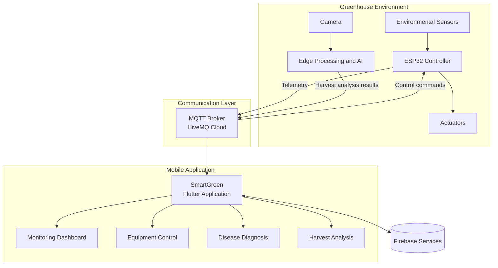
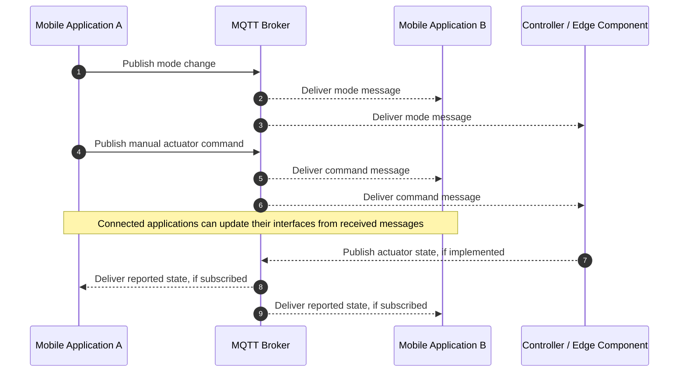
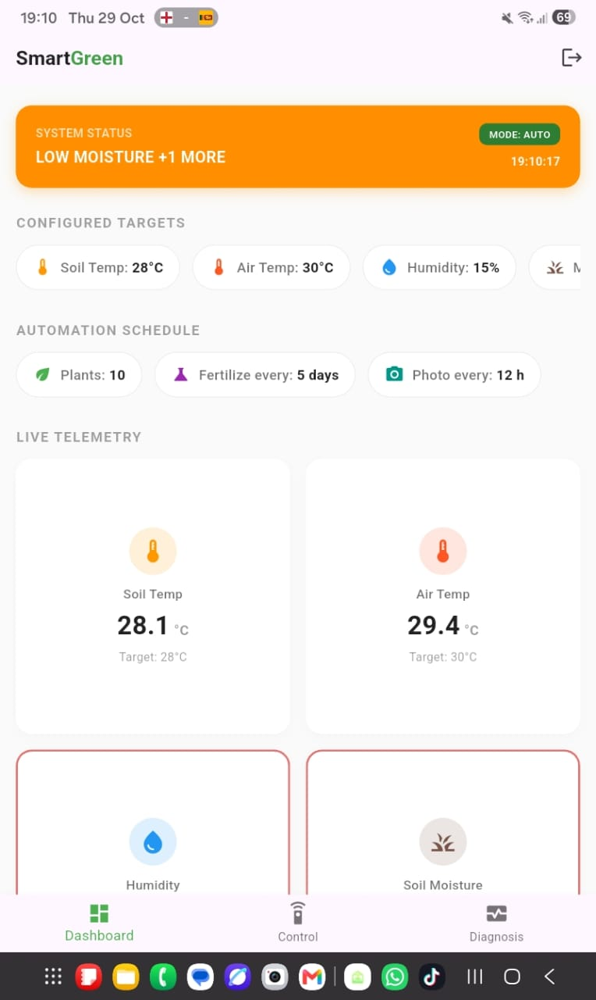
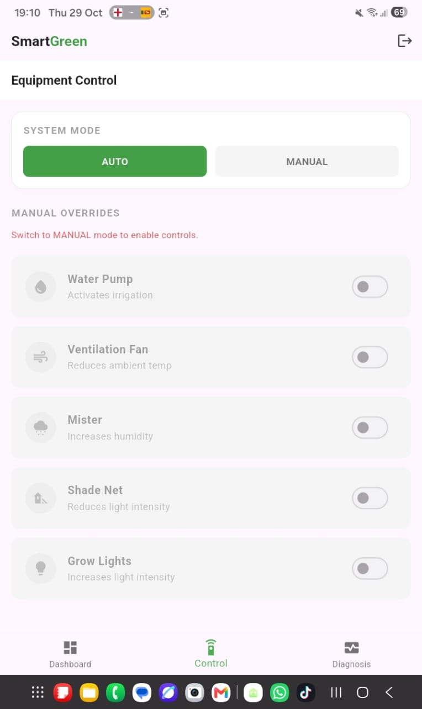
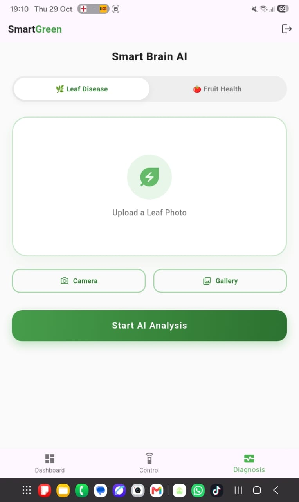

<p align="center">
  

<p align="center">
  
  
  
  
  
  
  
  
</p>

<p align="center">
  
  
  
  
</p>

## 1. Project Overview

**SmartGreen** is an IoT- and artificial intelligence (AI)-enabled greenhouse management system developed as an undergraduate Final Year Project at Horizon Campus, Sri Lanka. The system integrates environmental sensing, automated equipment control, edge-based image analysis, and a mobile application to support greenhouse monitoring and agricultural decision-making.

The mobile application is developed using Flutter and Dart. It provides an interface for monitoring environmental parameters, managing equipment, configuring environmental thresholds, and accessing AI-assisted plant disease diagnosis and harvest analysis results.

The system incorporates MQTT-based messaging for communication between connected components and Firebase services for supported application data storage.

This repository contains the SmartGreen mobile application and its associated system integration components.

## 2. Project Objectives

The principal objectives of SmartGreen are to:

- Monitor greenhouse environmental conditions using connected sensors.
- Support automated and manual control of greenhouse equipment.
- Apply computer vision techniques to fruit maturity detection and plant disease classification.
- Provide users with access to greenhouse information through a mobile application.
- Facilitate communication between the application and IoT components using MQTT.
- Support data persistence for selected application functions through Firebase.

## 3. Key Features

### 3.1 Environmental Monitoring

The application presents greenhouse environmental measurements, including:

- Air temperature
- Relative humidity
- Soil moisture
- Light intensity

Sensor measurements are communicated through the MQTT messaging system and displayed on the application dashboard.

### 3.2 Greenhouse Equipment Control

The application provides control interfaces for the following equipment:

- Water pump
- Ventilation fan
- Mister
- Shade net
- LED grow lights

The interface supports AUTO and MANUAL operating modes. In manual mode, users can configure a time-limited override for supported equipment, with a countdown display and automatic shut-off logic implemented in the application.

### 3.3 AI-Assisted Harvest Analysis

A YOLOv8-based object detection model is used for fruit detection and harvest-related analysis. The edge-processing component analyses camera images and communicates analysis results to the application through MQTT.

The reported model evaluation result is an mAP50 of 84.3%. This value should be interpreted in relation to the dataset, evaluation procedure, and experimental conditions used during model testing.

### 3.4 Plant Disease Diagnosis

A convolutional neural network (CNN) is used for plant leaf disease classification. The reported validation accuracy is approximately 91.8%.

The diagnosis interface allows users to access classification results produced by the AI component.

### 3.5 MQTT-Based Communication

The application uses MQTT to exchange messages with connected system components. HiveMQ Cloud is used as the MQTT broker in the cloud communication configuration, with TLS-enabled communication on port 8883.

### 3.6 Multi-Device Access

The application is designed to allow the same greenhouse system to be accessed from multiple phones. MQTT subscriptions support receiving published mode and manual-control messages while connected.

The consistency of actuator states, countdown timers, and reconnection behaviour depends on the implementation of message handling and state management across the application and edge components.

### 3.7 Configuration and Data Management

Firebase services support selected application functions, including authentication and cloud data storage. Administrative configuration interfaces provide a means of managing target environmental thresholds.

---

## 4. System Architecture

The system combines IoT hardware, edge processing, cloud messaging, AI-based analysis, and a Flutter application.



### 4.1 Data Flow

| Stage | Description |
|---|---|
| Environmental sensing | Sensors measure environmental conditions within the greenhouse. |
| Data transmission | The controller publishes telemetry through MQTT. |
| Edge processing | Camera images are processed using the configured AI models. |
| Application communication | The mobile application receives relevant telemetry, control messages, and analysis results. |
| Equipment management | Users issue manual-control commands, while the system supports automated operation. |
| Data storage | Selected application data is stored using Firebase services. |

*Note: This diagram represents the principal logical components. Actual communication paths and device responsibilities should be aligned with the implemented firmware, edge-processing scripts, and application code.*

---

## 5. Multi-Device Control and Manual Override

SmartGreen provides a manual-control interface for supported greenhouse equipment. When a user selects an operating mode or changes an equipment setting, the application publishes the corresponding message to the configured MQTT topic.

Other connected clients can receive these messages through their subscriptions. The application also implements timer-based manual overrides, allowing a selected device to be switched off after a configured duration.

The principal control workflow is illustrated below.



### Manual Override Behaviour

- Users can select a manual override duration between 1 and 60 minutes.
- The application displays the remaining time for an active local timer.
- The application publishes an OFF command when its manual timer expires.
- The application includes logic to return to AUTO mode when the last locally tracked manual override ends.
- Pressing AUTO cancels the active application timers and resets the local control interface.

**Implementation consideration:** Application-side timers are not automatically shared between phones. Reliable synchronization of actual hardware states and countdowns requires a shared state source and suitable timer management in the controller or edge component. Retained MQTT state messages or equivalent persistent state management can support clients that connect later.

---

## 6. Technology Stack

| Component | Technology | Purpose |
|---|---|---|
| Mobile application | Flutter, Dart | User interface and application logic |
| IoT controller | ESP32 | Sensor acquisition and equipment interfacing |
| Messaging protocol | MQTT | Communication between connected components |
| Cloud MQTT broker | HiveMQ Cloud | Message exchange over TLS |
| Cloud services | Firebase | Authentication and selected data storage |
| Object detection | YOLOv8 | Fruit detection and harvest analysis |
| Image processing | Python, OpenCV | Image processing and AI integration |
| Classification model | Custom CNN | Plant leaf disease classification |
| Environmental sensors | DHT22, BH1750, soil moisture sensor | Environmental measurements |
| Actuation hardware | Relays and connected devices | Irrigation, ventilation, misting, shading, and lighting |

---

## 7. MQTT Topics and Message Formats

The following topics represent the communication interface described for the application.

| Topic | Direction | Example payload | Purpose |
|---|---|---|---|
| `greenhouse/telemetry` | Edge/controller → application | `{"temp":28.4,"hum":71}` | Environmental monitoring |
| `greenhouse/fruit_result` | Edge processing → application | `{"ready":5}` | Harvest analysis results |
| `greenhouse/mode` | Application ↔ connected components | `{"mode":"MANUAL"}` | Operating-mode communication |
| `greenhouse/manual_cmd` | Application → connected components | `{"fan":"ON"}` | Manual equipment commands |

The exact payload fields must match those implemented by the publisher and subscriber on each component. The examples above are illustrative and should not be interpreted as a complete message schema.

---

## 8. AI Model Evaluation

SmartGreen integrates AI-based image analysis for two agricultural tasks.

| Model | Application | Reported result |
|---|---|---|
| YOLOv8 | Fruit detection and harvest analysis | 84.3% mAP50 |
| Custom CNN | Plant leaf disease classification | Approximately 91.8% validation accuracy |

The reported results describe the model evaluations conducted during development. They do not, by themselves, establish performance under all greenhouse conditions. Dataset composition, class distribution, image quality, and evaluation methodology should be considered when interpreting these metrics.

---

## 9. Hardware Components

| Component | Function |
|---|---|
| ESP32 | Microcontroller for IoT communication and connected hardware |
| DHT22 | Temperature and relative humidity measurement |
| BH1750 | Light intensity measurement |
| Soil moisture sensor | Soil moisture measurement |
| Relay modules | Electrical switching of supported actuators |
| Water pump | Irrigation |
| Ventilation fan | Air circulation |
| Mister | Humidity management |
| Shade net mechanism | Light exposure management |
| LED grow lights | Supplemental lighting |
| Camera and edge-processing device | Image capture and AI-based analysis |

The final hardware configuration should be documented according to the components actually used in the prototype.

---

## 10. Installation and Configuration

### 10.1 Prerequisites

- Flutter SDK and Dart SDK
- Android development environment
- A configured Firebase project
- A HiveMQ Cloud cluster or compatible MQTT broker
- Required IoT hardware and edge-processing components for hardware-level testing

### 10.2 Clone the Repository

Replace the placeholder with the actual repository URL.

```bash
git clone https://github.com/<your-username>/SmartGreen.git
cd SmartGreen
```

### 10.3 Configure Environment Variables

Create a `.env` file in the project root using the following structure:

```env
MQTT_USERNAME=your_mqtt_username
MQTT_PASSWORD=your_mqtt_password
```

Ensure that the application loads the environment file during initialization and that the required variables are available before establishing the MQTT connection.

The `.env` file should be excluded from version control. Use `.env.example` to document the required variable names without exposing credentials.

**Security note:** Environment variables bundled into a mobile application are not fully secret. For production deployments, use appropriately restricted broker credentials and access-control policies. Rotate any credentials that have previously been exposed.

### 10.4 Configure Firebase

Configure the Firebase project using the official FlutterFire setup procedure.

```bash
flutterfire configure
```

Add the platform-specific Firebase configuration required by the project. Do not commit private credentials or environment-specific secrets to the repository.

### 10.5 Install Dependencies and Run

```bash
flutter pub get
flutter run
```

Select a connected Android device or an available emulator when prompted.

---

## 11. Building the Android Application

To build a release APK, run:

```bash
flutter clean
flutter pub get
flutter build apk --release --split-per-abi
```

The generated APK files are normally located in:

```text
build/app/outputs/flutter-apk/
```

Verify that the Android application has the required internet permission and that environment configuration is included correctly in the Flutter build.

---

## 12. Project Structure

```text
SmartGreen/
├── lib/
│   ├── main.dart
│   ├── firebase_options.dart
│   └── screens/
│       ├── login_screen.dart
│       ├── dashboard_tab.dart
│       ├── control_screen.dart
│       ├── diagnosis_screen.dart
│       └── admin_configuration_screen.dart
├── android/
├── .env.example
├── pubspec.yaml
└── README.md
```

*The structure above is illustrative. Additional firmware, edge-processing, AI-model, and documentation directories may exist in the complete system repository.*

---

## 13. Application Screenshots

Screenshots can be added to the repository to demonstrate the implemented interfaces.

| Dashboard | Equipment Control | Disease Diagnosis |
|---|---|---|
|  |  |  |

Place the corresponding image files in `docs/screenshots/` and update the paths if the actual filenames differ.

---

## 14. Future Enhancements

The following items identify potential improvements beyond the currently described functionality.

- [ ] Implement persistent actuator-state reporting to improve synchronization across multiple phones.
- [ ] Synchronize timer start times and remaining durations across connected clients.
- [ ] Implement controller-side timer enforcement for reliable automatic shut-off.
- [ ] Improve reconnection handling and state recovery after network interruptions.
- [ ] Add historical environmental charts and data-export functionality.
- [ ] Implement push notifications for harvest results and significant environmental conditions.
- [ ] Expand model evaluation using additional images and varied greenhouse conditions.
- [ ] Strengthen MQTT access control and mobile application security.

These items should remain in the roadmap only where the functionality has not yet been completed and verified.

---

## 15. Project Team

**Undergraduate Final Year Project**  
**Degree Programme:** BSc (Hons.) in Networking and Mobile Computing  
**Institution:** Horizon Campus, Sri Lanka

| Team member |
|---|
| Amaya Wickramaarachchi |
| Dasun Weerawardhana |
| Gayashan Balasooriya |
| Ireshika Sewwandi |

---

## 16. Acknowledgements

The team acknowledges the academic guidance and technical support provided during the development of SmartGreen. The project also draws on open-source software, development frameworks, and machine-learning tools that support IoT integration and AI-based agricultural applications.

---

<p align="center">
  <em>SmartGreen — Integrating IoT, Edge Computing, and Artificial Intelligence for Greenhouse Management.</em>
</p>


<p align="center">
  
</p>

